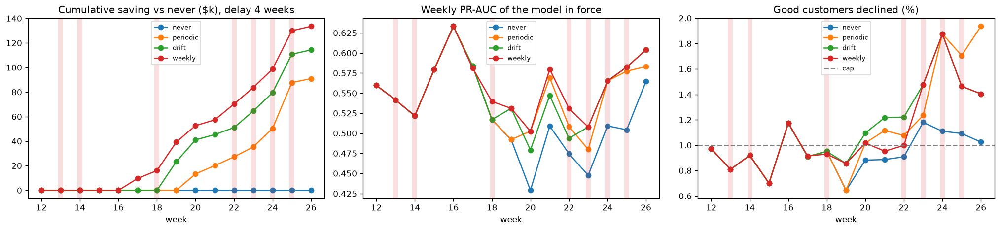
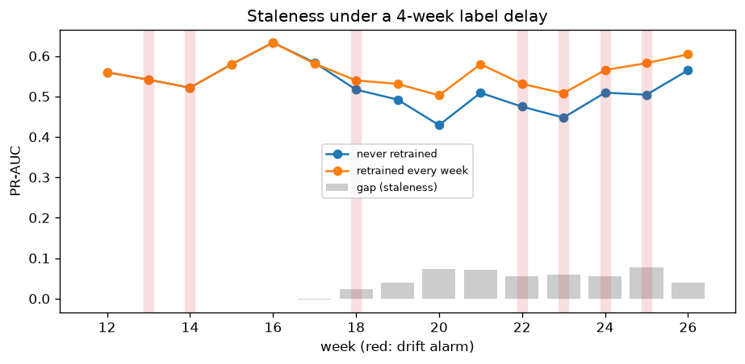
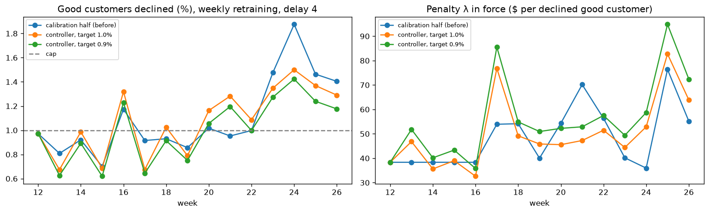

# P4 backtest: when to retrain

Weeks 12–26 replayed as if the system were live (296,347 transactions, 3.65% fraud), using the components tuned in [`tuning.md`](tuning.md). Notebook: [`09_backtest`](../notebooks/09_backtest.ipynb).

## Design

**Components.**
- *Scoring*: the tuned LightGBM structure (recency weights with a 4-week half-life, 255 leaves), with learning rate 0.1 instead of 0.05 to keep 13 model builds affordable.
- *Decision*: Platt calibration plus the cost rule capped at 1% of good customers declined. The 3-action rule is reported too.
- *Monitoring*: the tuned alarm rules from notebook 08.

**Timeline.**
- The system launches at week 12 with a model trained on weeks 0–11 (assumed to be history with mature labels).
- A week-w transaction gets its label at the end of week w + delay.
- A retrain at the end of week t uses labels up to max(11, t − delay), and the new model scores from week t + 1.
- A model never scores a week it was trained or calibrated on (unit-tested for every policy and delay).

**Each model build** trains on weeks ≤ E − 2. Weeks E − 1 and E are split by card holder: one half for early stopping, the other for calibration and the cap penalty λ.

**Policies.**
- *never*.
- *periodic*: every 4 weeks.
- *drift*: retrain in a week with an alarm; alarms fell in weeks 13, 14, 18, 22, 23, 24, 25.
- *weekly*: an upper bound on what retraining can give.

A retrain happens only if newer labels exist. Retraining cost is assumed at $50 (`monitoring.yaml`), and a break-even is reported.

**Label delays.** 2 weeks (optimistic), 4 weeks (main), 17 weeks (≈ the 120-day chargeback window).

## Results

Without any model the 15 live weeks cost **$1,907,930** (approve all). The never-retrained capped cost rule costs **$1,184,304**. Savings below are **on top of** that never-retrained baseline.

**Cost rule, capped at 1%** (95% CI over card holders):

| Delay | Policy | Retrains | Saving vs never | Break-even cost per retrain |
|---|---|---|---|---|
| 4 weeks | periodic | 2 | $91.0k (56.9k–132.6k) | $45.5k |
| 4 weeks | drift | 5 | $114.4k (75.6k–157.2k) | $22.9k |
| 4 weeks | **weekly** | 11 | **$133.5k** (90.7k–179.5k) | $12.1k |
| 2 weeks | periodic | 3 | $105.8k (65.0k–153.1k) | $35.3k |
| 2 weeks | drift | 6 | $151.2k (104.9k–203.0k) | $25.2k |
| 2 weeks | **weekly** | 13 | **$170.4k** (123.2k–223.3k) | $13.1k |
| 17 weeks | all four | 0 | $0 (no label matures in the window) | — |

**Policies compared directly** (paired):

| Comparison | Delay 4 | Delay 2 |
|---|---|---|
| drift vs periodic | +$23.4k (4.3k–42.8k) | +$45.4k (22.0k–74.9k) |
| weekly vs drift | +$19.2k (2.7k–36.4k) | +$19.2k (4.3k–34.5k) |
| weekly vs periodic | +$42.5k (19.0k–69.2k) | +$64.6k (43.2k–89.8k) |

**3-action rule** (delay 4): periodic +$29.5k (13.5k–47.6k), drift +$29.3k (13.4k–47.4k), weekly +$41.5k (22.8k–62.1k) vs never. The review queue absorbs part of what a stale model misses, so retraining matters less there.

**Sanity check.** Weekly retraining costs $372k over weeks 20–26, close to the $379k of the tuned, capped rule in notebook 07 on the same weeks.

## Staleness and H3

- **Models age quickly.** The never-retrained model scores PR-AUC 0.52–0.63 in its first 6 weeks and 0.43–0.51 in weeks 19–25. The correlation between model age and weekly PR-AUC is −0.44.
- From week 18 on, a model retrained every week is ahead by **0.02–0.08 PR-AUC** every week.
- **H3 (drift alarms precede performance drops): not supported.**
  - In the week after an alarm, the staleness gap averages 0.039; after a week without an alarm, 0.032. Almost no difference over 14 weeks.
  - Performance decays with age more or less steadily, whether or not an alarm fired.
  - The first alarms (weeks 13–14) came before any new label existed, so no policy could act on them.

## H5 and the answer to "when should we retrain?"

**H5 (drift-triggered retraining matches periodic retraining with fewer retrains): not supported as stated.**
- Drift-triggered retraining saved *more* than every-4-weeks retraining (+$23k with a 4-week delay, CI excludes 0), but needed *more* retrains (5 vs 2), because alarms cluster in weeks 22–25.
- Per retrain, periodic retraining was the more efficient. Retraining every week beat both.

**What decides it is economics.** Even the least efficient policy (weekly) saves about $12k per retrain. That is far above the compute cost of a retrain ($50 assumed), and plausibly above the human cost of validating and deploying one. So:

1. **Retrain as soon as new labels mature, e.g. weekly.** The binding constraint is label availability, not drift detection.
2. **Use drift alarms for investigation and safety, not as the retraining trigger.**
   - A block-missing alarm (pipeline break) means *stop and fix the data*; retraining on broken data would be wrong.
   - New-value and PSI alarms explain *why* performance moves.
3. **If retraining is expensive** (heavy validation, approvals), retraining every 4 weeks keeps about two thirds of the weekly gain ($91k of $134k) with 2 retrains instead of 11.

## Two problems the replay exposed

**1. The decline cap drifts.**
- With models retrained from only two weeks of holdout data, the weekly share of good customers declined ranged from 0.64% to **1.94%**: mean 1.10–1.14% for the retrained policies, 0.94% for never.
- The penalty λ is estimated on a small calibration half, so it is noisy: $36–$76 across model builds.
- Fixed below with a weekly, label-free controller that aims below the hard cap.

**Fix: a label-free λ controller** ([`10_cap_control`](../notebooks/10_cap_control.ipynb), replayed on the same cached models).
- At the end of each week, the model in force next week scores last week's whole traffic (about 20k transactions).
- λ is set so the *expected* share of good customers declined, Σ(1−p) over declines / Σ(1−p), hits a target. No labels are needed.
- In production this is `python -m fraud.serving.cap` run on the API's logged probabilities.

Weekly share of good customers declined, 4-week label delay:

| Policy | λ from calibration half (before): mean / worst week | Controller, target 1.0% | **Controller, target 0.9%** | Extra cost of 0.9% target (15 weeks) |
|---|---|---|---|---|
| weekly | 1.10% / **1.88%** | 1.08% / 1.50% | **1.00% / 1.42%** | +$21.8k (12.8k–31.6k) |
| drift | 1.14% / **1.88%** | 1.08% / 1.50% | **1.00% / 1.42%** | +$24.4k (16.5k–33.5k) |
| periodic | 1.14% / **1.94%** | 1.07% / 1.50% | **0.99% / 1.42%** | +$24.4k (13.8k–36.9k) |
| never | 0.94% / 1.18% | 0.99% / 1.42% | 0.91% / 1.31% | +$8.6k (1.3k–15.9k) |

- **What it fixes:** the systematic overshoot. With a 0.9% target, the realised mean sits at the 1% cap, and the worst week falls from 1.9% to 1.4%. The 0.9% target is now the default (`costs.yaml: controller_target`).
- **What it costs:** about $22–24k over 15 weeks against $1.05–1.18M of decision cost. That is the price of actually honouring the cap.
- **What it does not fix:** week-to-week variation. The controller reacts one week late (see weeks 16, 24), and the realised weekly rate still ranges from 0.6% to 1.4% (7–8 of 15 weeks above 1%). It can only steer the *expected* rate, so its accuracy is bounded by calibration error on new traffic; the realised mean ran about 0.08 points above the expected value.
- **A hard weekly guarantee is not achievable without labels.** The honest business statement is "about 1% on average, rarely above 1.5%". In production the declined transactions are never labelled anyway, so the realised rate can only be estimated, for example from customer complaints or a small random approval sample.

**2. A 120-day label window makes retraining impossible for months.** With 17-week label maturity, no new label arrives within 15 weeks of launch, and every policy equals never. A real deployment needs **faster labels**:
- the outcomes of manually reviewed transactions (the 3-action rule creates them every day);
- early dispute signals, or customer confirmations.

The data cannot test these, but the review queue is a natural source.

## Limitations

- **The alarm thresholds were tuned on weeks that overlap this replay**, so the drift policy has a mild look-ahead advantage.
- **Learning rate 0.1** (instead of 0.05) and a single seed per model. Model-to-model noise (for example the λ spread) is not averaged out.
- **Label delay is simulated as a fixed lag.** Real chargebacks arrive over a spread of days, and the data has no chargeback dates.
- **Warm start.** Weeks 0–11 are assumed fully labelled at launch.
- **Retrain counts include end-of-window retrains.** A retrain at the end of week 26 (weekly policy) has no effect inside the window, and one at the end of week 25 only affects the 2,754 transactions of the partial week 26. Break-even values per retrain are therefore slightly understated (weekly, delay 4: $13.4k over 10 effective retrains instead of $12.1k over 11).
- **Blocked transactions keep their true labels here.** In production they would never be labelled (feedback loop), which would bias retraining. Not modelled.
