# Data analysis for the problem

What the labelled train data (590,540 transactions, 6 months) says about each part of the problem in [`docs/problem_framing.md`](../docs/problem_framing.md), before any method is chosen. Reproduced by [`notebooks/00b_problem_data_analysis.ipynb`](../notebooks/00b_problem_data_analysis.ipynb); figures are in `reports/figures/da_*.png`. Rates come with 95% Wilson intervals where the notebook shows them.

General facts about files, columns and missingness are in [`docs/data_dictionary.md`](../docs/data_dictionary.md) and are not repeated here.

---

## A. Unit of analysis: transactions or card holders?

**Question.** Labels spread between transactions of the same card holder. How unevenly are transactions spread over card holders?

| | Value |
|---|---|
| Card holders (`entity_key`, approximate) | 217,850 |
| Transactions per card holder | median 1, p90 6, p99 20, max 1,414 |
| Card holders with a single transaction | 57.5% |
| Transactions from card holders with ≥ 10 transactions | 29.8% |
| Fraud rate per transaction / card holders with any fraud | 3.50% / 3.73% |

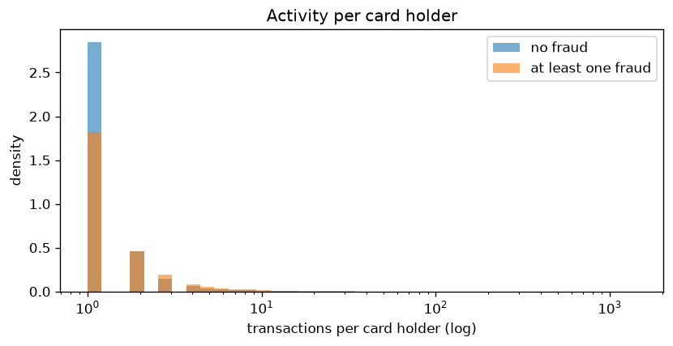

**Reading.** Most card holders appear once, but the 30% of traffic from repeat customers carries the history that behavioural signals depend on.

**Implication.** Statistics over transactions are not over independent units. Uncertainty estimates must account for card holders (P1), and "new" vs "returning" customers are two different populations.

---

## B. Money (P2): where is the loss?

**Question.** The decision is priced in dollars. Where do the fraud dollars sit?

**Approve-all baseline** (no model): **$3,083,845** of fraud over 6.0 months, about **$516k per month**, or 3.87% of all dollars processed. The mean fraud is $149, the mean legitimate transaction $135.

**Loss is concentrated.**

| Largest frauds (by amount) | Share of fraud dollars |
|---|---|
| 1% | 10.7% |
| 5% | 30.8% |
| 10% | 45.1% |
| 20% | 62.9% |
| 50% | 87.7% |

**Frequency is not loss, by amount:**

| Amount ($) | Share of transactions | Fraud rate (95% CI) | Share of fraud dollars |
|---|---|---|---|
| < 25 | 8.6% | **6.20%** (5.99–6.41) | 1.6% |
| 25–50 | 26.0% | 3.05% | 5.8% |
| 50–100 | 27.8% | 2.92% | 11.5% |
| 100–200 | 21.7% | 3.05% | 18.1% |
| 200–500 | 12.0% | 4.42% | **32.5%** |
| 500–1k | 2.6% | 5.31% | **20.7%** |
| > 1k | 1.2% | 2.46% | 9.8% |

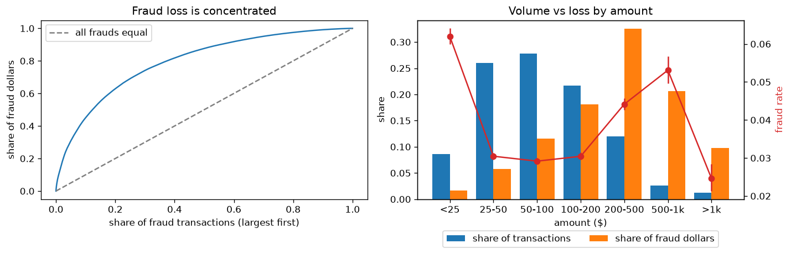

**Frequency is not loss, by product:**

| ProductCD | Share of transactions | Fraud rate | Share of fraud dollars | Fraud $ / all $ in product |
|---|---|---|---|---|
| W | 74.5% | 2.04% | **66.6%** | 3.1% |
| C | 11.6% | **11.69%** | 12.7% | **13.3%** |
| R | 6.4% | 3.78% | 11.3% | 5.5% |
| H | 5.6% | 4.77% | 8.0% | 10.2% |
| S | 2.0% | 5.90% | 1.4% | 6.2% |

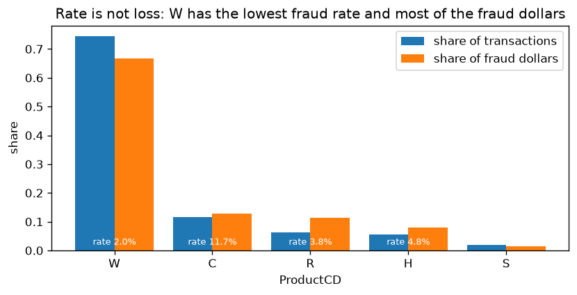

**Amounts with three decimals are product C only** (10.5% of transactions, fraud rate 11.72%), which suggests currency-converted payments. Amounts with exactly two decimals have the lowest fraud rate (1.04%); whole-dollar amounts carry 75.5% of fraud dollars.

**Reading.**
- Small transactions (< $25) have the highest fraud rate but cost little; $200–$1,000 transactions are 15% of volume and **53% of fraud dollars**.
- Product W has the lowest fraud rate and **two thirds of the loss**. Product C has the highest rate, and fraud is 13% of its dollar volume.

**Implication.**
- Optimising "how many frauds are caught" and "how many dollars are saved" leads to different answers. P2 must be judged in dollars, and amount must enter the decision, not only the score.
- The approve-all baseline is about $516k per month: this is the scale any saving should be compared with.

---

## C. Signal (P1): which attributes separate fraud?

**Question.** Where does the information about fraud sit, and how much of it is independent?

**Signal by column family.** Mutual information with `isFraud` in nats, on a 100k sample. Every family beats a label-permutation null.

| Family | Best column | MI best | MI median column |
|---|---|---|---|
| V1–V339 | V258 | 0.0162 | 0.0049 |
| DeviceInfo | — | 0.0140 | |
| C1–C14 | C8 | 0.0120 | 0.0067 |
| R_emaildomain | — | 0.0113 | |
| id_01–38 | id_31 | 0.0113 | 0.0075 |
| D1–D15 | D8 | 0.0104 | 0.0073 |
| ProductCD | — | 0.0102 | |
| addr1–2 | addr2 | 0.0090 | 0.0089 |
| card1–6 | card3 | 0.0090 | 0.0025 |
| M1–M9 | M4 | 0.0085 | 0.0037 |
| DeviceType | — | 0.0081 | |
| dist1–2 | dist2 | 0.0035 | 0.0033 |
| TransactionAmt | — | 0.0033 | |
| P_emaildomain | — | 0.0029 | |

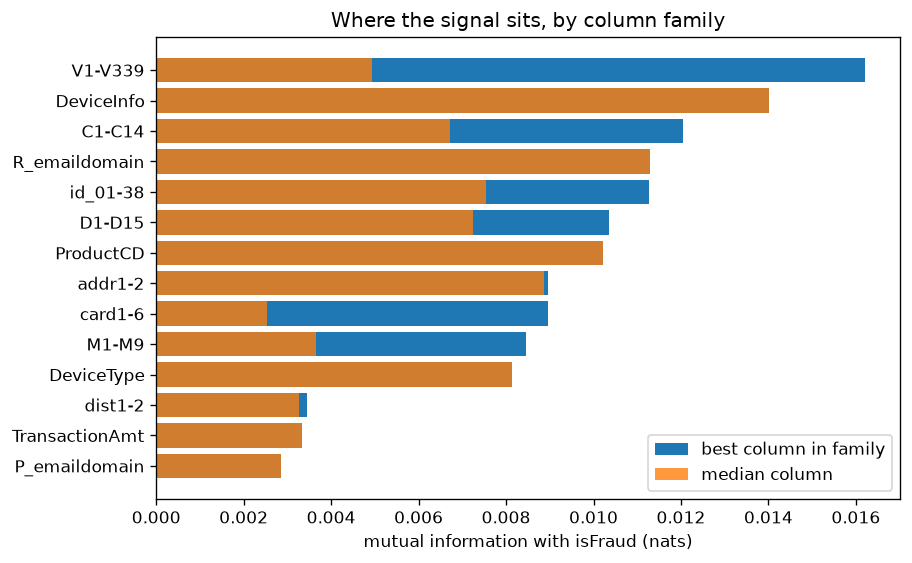

The label itself carries H(3.5%) ≈ 0.152 nats. The best single column explains about 0.0162 / 0.152 ≈ 11% of it: **no single attribute is close to sufficient.** Amount alone is among the weakest columns.

**A small MI can hide a very risky slice.** MI averages over all rows. The top column, V258, gets most of its information from 1% of transactions:

| V258 | Share of transactions | Fraud rate (95% CI) |
|---|---|---|
| missing | 77.9% | 2.28% (2.23–2.32) |
| 1 | 19.1% | 3.97% (3.86–4.09) |
| 2 | 1.9% | 16.9% (16.2–17.6) |
| ≥ 3 | **1.05%** | **61.2%** (60.0–62.4) |

**Categorical attributes** (rate with 95% CI): credit 6.7% vs debit 2.4%; discover 7.7% vs visa and mastercard about 3.4%; mobile 10.2% vs desktop 6.5% vs no device data 2.1%; `M4 = M2` 11.4%; hotmail 5.3%, gmail 4.4%, yahoo 2.3%.

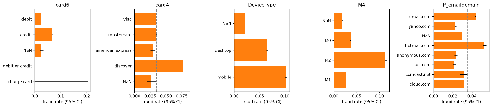

**Numeric attributes by class.**
- Fraud is concentrated on **young relationships**: `D1 = 0` for 57% of frauds vs 47% of legitimate transactions, and `D15 = 0` for 48% vs 35%.

  `D1` is commonly read as days since the card or account was first used (the exact meaning is masked). By card age, the riskiest group is 1–30 days, not day 0:

  | D1 (card age, days) | Share of transactions | Fraud rate (95% CI) |
  |---|---|---|
  | 0 | 47.4% | 4.21% (4.13–4.28) |
  | 1–30 | 12.9% | **6.29%** (6.12–6.46) |
  | > 30 | 39.4% | **1.73%** (1.68–1.79) |
  | missing | 0.2% | 3.62% (2.73–4.80) |

- `C5 = 0` for 91% of frauds vs 62% of legitimate transactions.
- `C1` tends to be larger for fraud, but the relation is **not monotonic**:

  | C1 | Share of transactions | Fraud rate (95% CI) |
  |---|---|---|
  | 0–1 | 53.7% | 2.48% (2.42–2.53) |
  | 2–3 | 26.5% | 3.21% (3.13–3.30) |
  | 4–10 | 12.9% | 5.28% (5.13–5.44) |
  | 11–100 | 3.5% | **12.95%** (12.49–13.41) |
  | > 100 | 3.4% | 5.45% (5.14–5.77) |

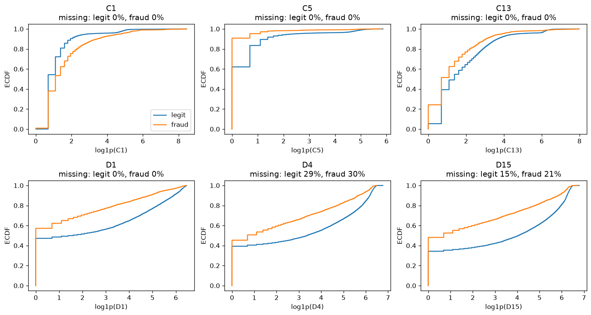

**Time of day.** Volume is lowest at hour 9 and highest at hour 19 of the (unknown) reference clock. The fraud rate ranges from 2.3% (hour 13) to **10.6% (hour 7)**: fraud is most frequent when legitimate traffic is lowest.

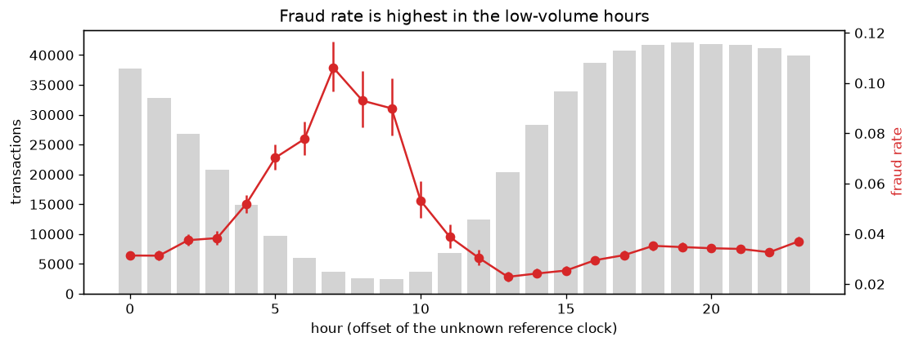

**Interaction: product × device data.** Product W **never** has an identity record, while C, H, R and S almost always do. "Has device data" therefore largely means "is not product W". Within product C, transactions with device data have 12.3% fraud vs 5.8% without (n = 6,327).

**Redundancy.**
- C1–C14: 38 of 91 pairs have |r| > 0.9.

  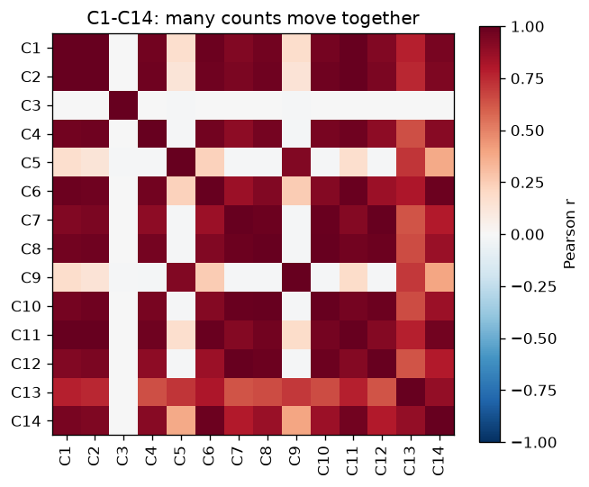

- The 339 V columns need 122 principal components to keep 95% of the variance inside their 14 blocks. Block V322–V339 is the most redundant (median |r| 0.72, 5 components for 18 columns).

**Reading.** The signal is spread thinly over many families: device, counts, time deltas, email, product, card type. Strong signal often sits in small slices (V258 ≥ 3) and in non-monotonic relations (C1). Cards 1–30 days old are 3.6× riskier than cards older than 30 days. Several apparent effects are confounded (device data ↔ product), and many columns repeat each other.

**Implication.** P1 needs a model that combines many weak, partly redundant, partly missing signals. Single-attribute rules will not get far. Confounding means single-attribute fraud rates should not be read as causal.

---

## D. Time (P3): what is stable and what changes?

**Question.** How much do things move from week to week when nothing is known to be wrong?

**Weekly fraud rate** (full weeks): 1.85% to 5.06%. **Weekly fraud dollars:** $86.7k to $167.6k.

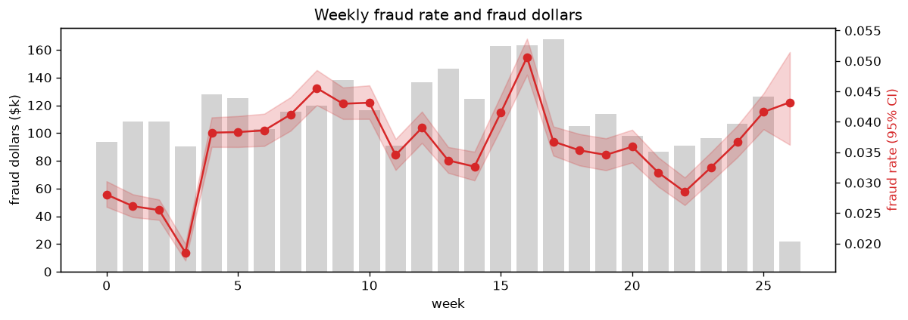

**By product and month:**

| Month | W | C | R | H | S |
|---|---|---|---|---|---|
| 2017-12 | 1.9% | 8.2% | **1.0%** | **1.8%** | **2.6%** |
| 2018-01 | 2.1% | 12.7% | 10.0% | 14.2% | 7.6% |
| 2018-02 | 2.1% | 12.5% | 9.1% | 12.7% | 10.4% |
| 2018-03 | 2.2% | 12.8% | 6.5% | 9.6% | 7.8% |
| 2018-04 | 2.1% | 12.4% | 4.5% | 5.9% | 6.3% |
| 2018-05 | 1.8% | 13.4% | 4.9% | 6.3% | 5.3% |

W is flat; C is stable after December; H, R and S jump between December and January, then drift down.

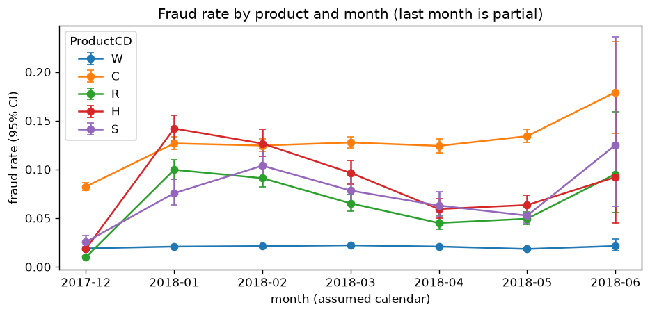

**Missing-rate blocks change abruptly.** Inside the train period, 11 of the 14 V blocks move by 35–51 percentage points, mostly in a single step between week 3 and week 4 (end of December). Some blocks go from ~45% to ~85% missing, others from ~40% to ~10%. They then stay roughly flat, apart from smaller bumps around week 18.

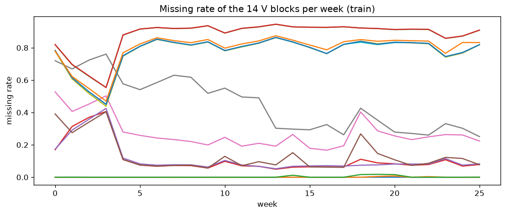

**New categorical values keep arriving.**
- `card1`: 10.7% of rows carry a never-seen card code in week 1, decaying to about 1% per week.
- `DeviceInfo`: 1–4% per week.
- `id_31` (browser): mostly near 0, with spikes of **18.6% in week 9 and 24.4% in week 22**, consistent with browser releases.
- Email domains: essentially never new.

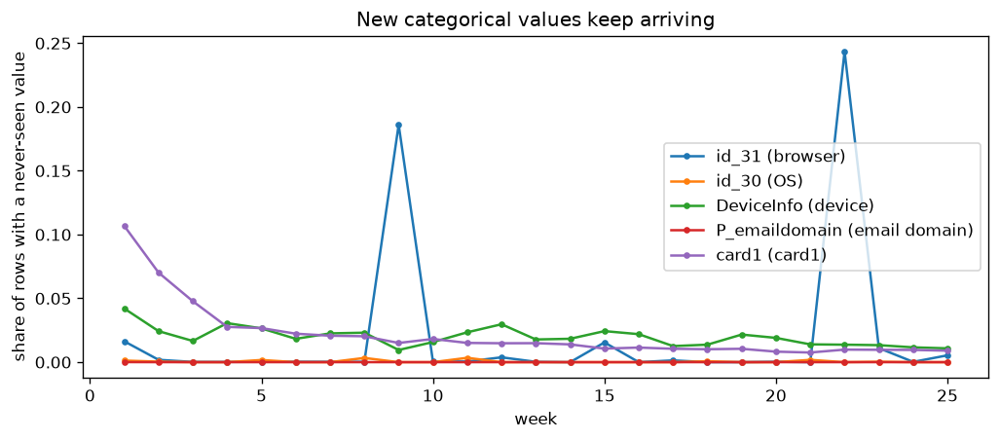

**Relations change, not only distributions.**
- Credit cards: 3.6% fraud in December, 9.6% in February, 6.3% in May. Debit stays at 2.0–2.8%.
- Mobile: 4.6% in December, 14.4–15.4% in January to March, 9.8% in April.

The gap between categories, i.e. how much an attribute tells about fraud, changes over months.

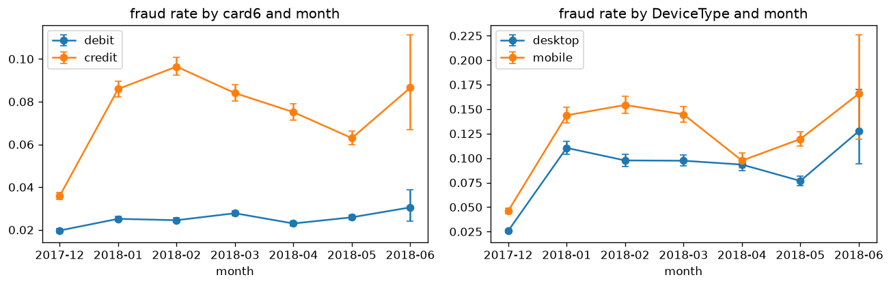

**Reading.** Three kinds of change are visible in labelled data:
1. Step changes in data collection (missing-rate blocks at week 4).
2. Recurring new values (browser releases).
3. Changes in the relation between attributes and fraud (credit, mobile, products H/R/S).

December 2017 (weeks 0–3) looks like a different regime on several axes at once.

**Implication.**
- A monitor (P3) must tolerate week-to-week noise of a few points in fraud rate. It must separate step changes in data collection from changes in fraud itself, and expect browser-release spikes as normal.
- The week-4 step is a real, labelled shift: it can be used to check whether a monitor reacts to a known change.

---

## E. Labels (P4): how are they structured?

**Question.** What does label propagation look like in the data, and what does it mean for label delay?

| | Value |
|---|---|
| Card holders with fraud | 8,116 |
| Fraud transactions in card holders with more than one fraud | **78.0%** |
| Fraud streak (first to last fraud), days | median 0.0, p75 0.7, p90 13.1, max 181 |
| Fraud card holders with legitimate transactions before the first fraud | 25.5% |
| … between frauds | 11.2% |
| … after the last fraud | 24.3% |

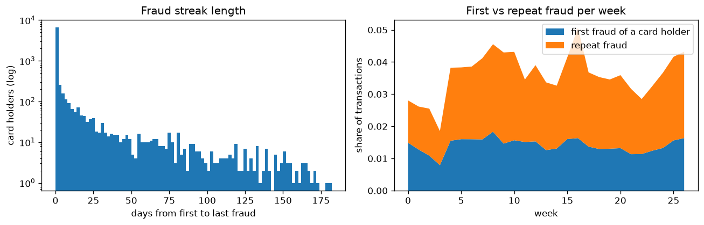

**First vs repeat fraud per week.**
- The rate of first-time fraud is fairly flat at about 1.1–1.8% per week. The exception is week 3 (0.8%), the busiest holiday week.
- Repeat fraud is **1.1–1.5% in weeks 0–3** and **1.7–3.4% (median 2.3%) in weeks 4–25**.

**Reading.**
- Most fraud comes in bursts from the same card holder, usually within a day. One in ten streaks lasts two weeks or more.
- A quarter of fraud card holders have clean history before their first fraud.
- Legitimate transactions after the last fraud (24%) are not what strict propagation would produce. Either the card-holder key is imperfect, or propagation follows account, email and address rather than card.
- **Hypothesis, not verified:** repeat fraud is low at the start because labels only spread *forward* from a chargeback, and the first weeks have no earlier chargebacks to spread from (left censoring). This would make the start of the data look cleaner than it was. It may also interact with the December data-collection change in D.

**Implication.**
- Most labels are "repeat" labels: a model can score well by recognising card holders already caught (consistent with M1).
- For P4, a large part of the label signal for a card holder arrives within days of the first fraud, but the first chargeback itself can take up to 120 days. Label delay is therefore not one number; it differs between first and repeat frauds.

---

## F. Data quality

- **24 near-constant columns** (one value, NaN included, on ≥ 99% of rows): V305 (100%), C3 (99.6%), V107–V122 (99.0–99.9%), id_07, id_08, id_21–id_27 (~99.1%).
- **Negative values.** Rare in time deltas (D4: 15 rows, D15: 15, D11: 7, D6: 3, D14: 3, D12: 2), so likely errors. Common in several `id_*` columns (id_01: 124,678 rows; id_14: 79,113; id_06: 45,540), so likely part of their encoding (id_14 may be a time-zone offset). Not verifiable because the names are masked.
- **Duplicates.** 487 rows are identical to another row on every input column (only time and ID differ).
- **Time-dependent missingness.** See D: whether a column is missing depends on the week, not only on the transaction.

**Implication.** Near-constant columns carry almost nothing and inflate any per-column monitoring. Rare negative time deltas should be checked, not silently used.

---

## Summary: findings and the sub-problems they affect

| # | Finding | P1 score | P2 decide | P3 monitor | P4 retrain |
|---|---|:-:|:-:|:-:|:-:|
| 1 | Loss is concentrated: $200–$1k = 15% of volume, 53% of fraud dollars | | ✔ | | |
| 2 | Rate ≠ loss: product W has the lowest rate and 67% of fraud dollars | | ✔ | ✔ | |
| 3 | Approve-all baseline ≈ $516k fraud per month | | ✔ | | ✔ |
| 4 | Signal is thin and spread over many families; the best column explains ~11% of label entropy, mostly through a 1% slice with 61% fraud | ✔ | | | |
| 4b | Young cards (1–30 days) have 6.3% fraud vs 1.7% for cards older than 30 days; C1 risk is non-monotonic | ✔ | | | |
| 5 | Device data ↔ product W are confounded | ✔ | | ✔ | |
| 6 | Strong redundancy (C: 38/91 pairs with r > 0.9; V: 339 columns → 122 components) | ✔ | | ✔ | |
| 7 | Fraud rate peaks in the low-traffic hours (10.6% at hour 7) | ✔ | | | |
| 8 | December 2017 is a different regime (block missingness step at week 4, low fraud in H/R/S) | ✔ | | ✔ | ✔ |
| 9 | New browser values arrive in spikes (up to 24% of rows in a week) | | | ✔ | |
| 10 | Attribute–fraud relations change over months (credit, mobile) | ✔ | | ✔ | ✔ |
| 11 | 78% of fraud is repeat fraud within the same card holder; streaks are mostly < 1 day | ✔ | | | ✔ |
| 12 | Repeat fraud is lower in the first weeks (possible left censoring of labels) | | | | ✔ |
| 13 | 24 near-constant columns; rare negative time deltas; 487 duplicate rows | ✔ | | ✔ | |
