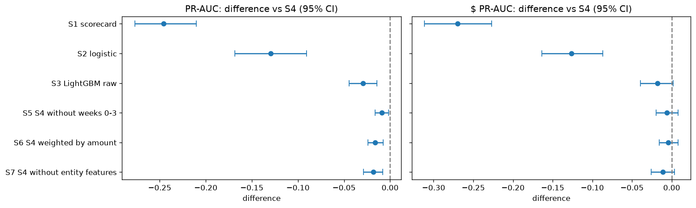
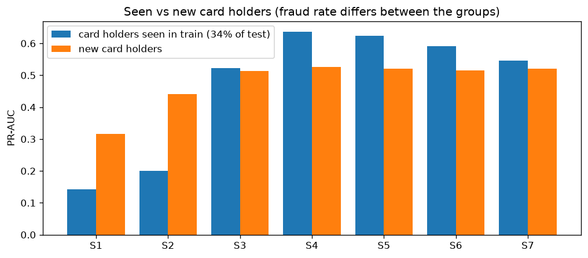
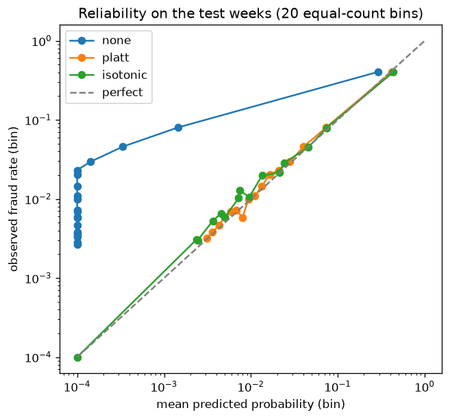
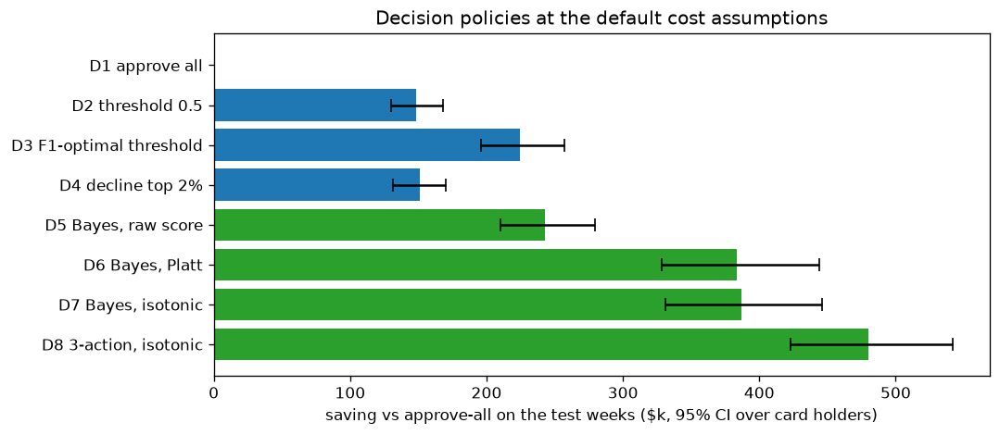
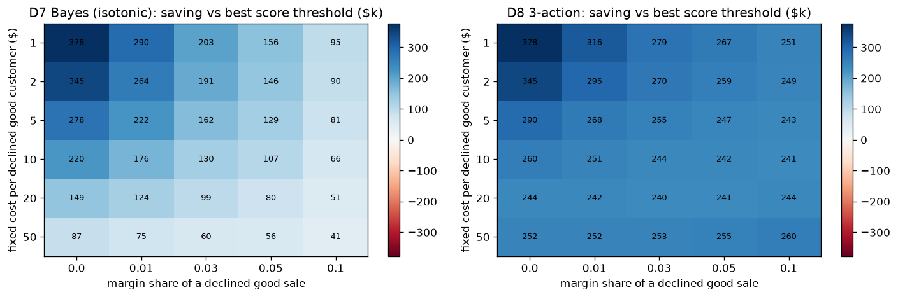
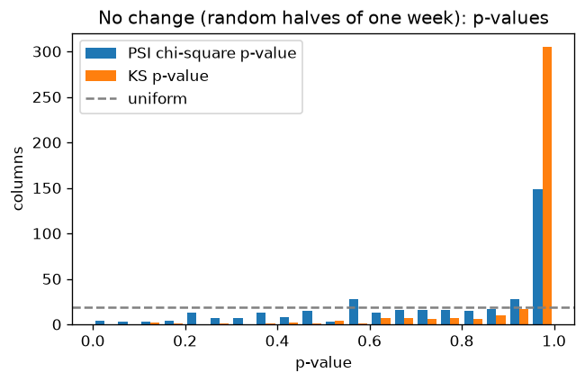
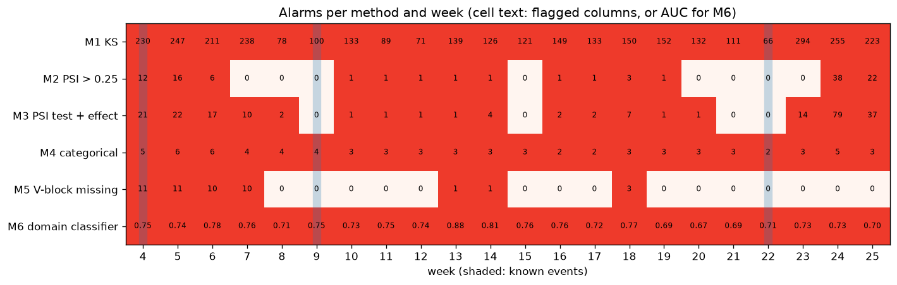
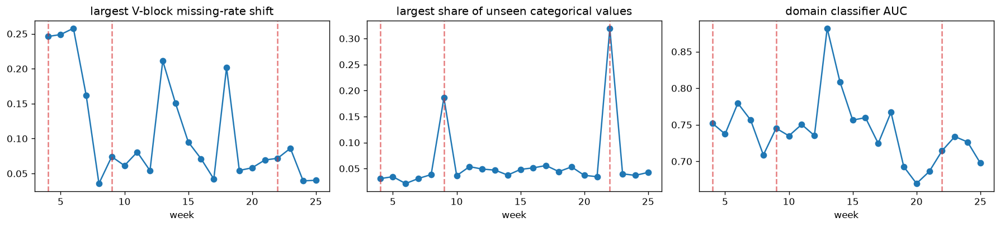
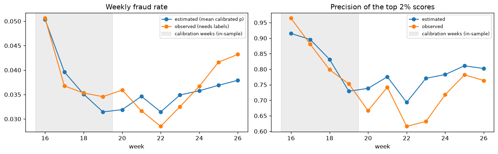

# Method research: initial results

For each sub-problem in [`docs/problem_framing.md`](../docs/problem_framing.md), several candidate methods were chosen **because of a finding** in [`data_analysis.md`](data_analysis.md) and run once on real data, **without tuning**. This report gives the first results and a verdict per candidate: **chosen**, **to tune**, or **rejected**. Method rationale is in [`docs/methodology.md`](../docs/methodology.md).

| Sub-problem | Notebook | Data |
|---|---|---|
| P1 scoring | [`03_method_scoring`](../notebooks/03_method_scoring.ipynb) | train weeks 0–15, valid 16–19, test 20–26 |
| P2 decision | [`04_method_decision`](../notebooks/04_method_decision.ipynb) | reference-model scores: calibrate on valid, evaluate on test |
| P3 monitoring | [`05_method_monitoring`](../notebooks/05_method_monitoring.ipynb) | weeks 4–25, each against the 4 weeks before it |

All intervals are 95% bootstrap CIs over card holders.

## Summary

| | Candidate | Verdict | Reason |
|---|---|---|---|
| P1 | S4 LightGBM + past-only behaviour features | **chosen**, to tune | Best PR-AUC; every alternative is significantly worse. Worst log loss, 2,488 trees. |
| P1 | S5 train without December 2017 | to tune | Slightly lower PR-AUC, best dollar capture at 3% |
| P1 | S7 without card-holder behaviour features | to tune (validation protocol) | Its 6 features help mainly on known card holders |
| P1 | S1 scorecard, S2 logistic, S3 raw LightGBM, S6 amount-weighted training | rejected | Significantly worse, or no dollar gain |
| P2 | Calibration (Platt ≈ isotonic) | **chosen** | ECE 0.0197 → 0.0019; log loss 0.171 → 0.092 |
| P2 | D7 Bayes cost rule on calibrated p | **chosen**, with a constraint to add | Saves $387k vs $149k for threshold 0.5, but declines 6.7% of good customers |
| P2 | D8 approve / review / decline | **chosen**, to tune | Saves $480k; best in 28 of 30 cost scenarios; depends on review assumptions |
| P3 | M5 missing rate per V block | **chosen** | Catches the week-4 step; its other alarms are real block changes |
| P3 | Share of never-seen categorical values (from M4) | **chosen** | Exactly the two browser releases, nothing else |
| P3 | M3 PSI with test + effect floor | to tune (alarm count) | Catches week 4 and an unexplained change in weeks 23–25; 1–2 columns flagged most weeks |
| P3 | M1 KS, M2 PSI > 0.25, M4 JS rule as set, M6 domain classifier | rejected as alarms | Alarm almost every week or miss known events |

---

## P1. Scoring

**Candidates and the finding behind each.**
- **S1** scorecard: weight of evidence (naive Bayes) of the 8 attributes from the analysis (finding C).
- **S2** logistic regression (C).
- **S3** LightGBM, raw columns (C: non-monotonic relations, informative NaN).
- **S4** S3 + past-only behaviour features, the reference (C: young cards; E: repeat fraud).
- **S5** S4 trained without weeks 0–3 (D: December 2017 regime).
- **S6** S4 with sample weights ∝ amount (B: loss is concentrated).
- **S7** S4 without the 6 `entity_key` behaviour features (E: 78% repeat fraud, memorisation risk).

| Model | PR-AUC | $ PR-AUC | $ caught at 1% / 3% declined | PR-AUC seen / new card holders | Log loss | Trees |
|---|---|---|---|---|---|---|
| S1 scorecard | 0.288 (0.255–0.327) | 0.178 | 6.8% / 13.1% | 0.143 / 0.316 | 0.177 | — |
| S2 logistic | 0.404 (0.365–0.448) | 0.321 | 12.6% / 30.4% | 0.200 / 0.440 | 0.111 | — |
| S3 LightGBM raw | 0.505 (0.474–0.532) | 0.430 | 13.6% / 38.4% | 0.522 / 0.513 | 0.099 | 247 |
| **S4 + past features** | **0.534** (0.504–0.561) | **0.448** | **16.3%** / 40.7% | **0.637** / 0.526 | 0.171 | 2,488 |
| S5 without weeks 0–3 | 0.525 (0.495–0.552) | 0.442 | 16.0% / **42.8%** | 0.623 / 0.521 | 0.162 | 1,660 |
| S6 weighted by amount | 0.518 (0.488–0.545) | 0.444 | 16.2% / 34.9% | 0.591 / 0.516 | 0.160 | 2,115 |
| S7 without entity features | 0.516 (0.486–0.545) | 0.437 | 15.5% / 40.1% | 0.546 / 0.521 | **0.098** | 238 |

Test: 121,163 transactions, 3.45% fraud. 33.9% of test rows come from card holders seen in the training weeks; their fraud rate is 1.66%, against 4.37% for new card holders.

**Paired difference vs S4** (positive = better than S4):

| Model | PR-AUC | $ PR-AUC |
|---|---|---|
| S1 | −0.246 (−0.277, −0.210) | −0.270 (−0.312, −0.227) |
| S2 | −0.130 (−0.168, −0.091) | −0.127 (−0.164, −0.087) |
| S3 | −0.029 (−0.044, −0.015) | −0.018 (−0.039, +0.002) |
| S5 | −0.009 (−0.017, −0.002) | −0.006 (−0.019, +0.008) |
| S6 | −0.016 (−0.024, −0.007) | −0.005 (−0.016, +0.008) |
| S7 | −0.018 (−0.029, −0.008) | −0.011 (−0.026, +0.004) |




**Reading.**
- **The analysis alone is a real baseline.** Eight attributes in a scorecard reach PR-AUC 0.288, 8× a random model (0.035). Its strongest evidence matches the analysis: V258 ≥ 3 (+3.7 nats), C1 11–100 (+1.4), product C (+1.2), mobile (+1.1), hours 5–11 (+0.7). A flexible model still adds a lot on top: S4 is +0.246.
- **Non-linear models win clearly.** LightGBM beats logistic regression by 0.13 PR-AUC.
- **Past-only behaviour features help:** S4 vs S3 is +0.029 on PR-AUC. On $ PR-AUC the CI just touches 0.
- **Most of what the card-holder features add is on known card holders.** Removing them (S7) lowers PR-AUC on seen card holders from 0.637 to 0.546 and on new ones only from 0.526 to 0.521. These features use no labels, so this is not label leakage. It is the model recognising the history of returning customers, which is legitimate at decision time but will not transfer to new customers.
- **Training length.** S4 needs 2,488 trees and has the worst log loss; S7 stops at 238 trees with the best log loss. Early stopping on validation weeks that share card holders with training may reward that recognition. The validation protocol is the first thing to tune.
- **Dropping December (S5)** costs 0.009 PR-AUC but catches the most fraud dollars at a 3% decline budget (42.8% vs 40.7%). Neither "keep all weeks" nor "drop the regime" is clearly right; recency weighting is a candidate.
- **Weighting training by amount (S6)** does not raise dollar-weighted PR-AUC (−0.005, CI includes 0) and catches fewer dollars at 3% (34.9%). Amount is better handled in the decision rule (P2) than in training.

**Next (tuning):**
- Validation protocol for early stopping: card-holder-disjoint validation, or a fixed number of trees.
- Recency weighting vs a fixed training window.
- Then hyperparameters.

---

## P2. Decision

**Calibration** (fitted on valid, judged on test):

| | Mean p (observed 0.0345) | Log loss | Brier | Reliability ↓ | Resolution ↑ | ECE |
|---|---|---|---|---|---|---|
| none | 0.0147 | 0.1710 | 0.0239 | 0.00117 | 0.00643 | 0.0197 |
| Platt | 0.0341 | **0.0916** | **0.0220** | **0.00001** | 0.00643 | **0.0019** |
| isotonic | 0.0343 | 0.0917 | 0.0221 | 0.00004 | 0.00607 | 0.0032 |



The raw scores **underestimate** risk: their mean is 1.5% for an observed 3.45%, and whole bins scored below 0.0001 contain 0.3–2% fraud. Both calibrators fix this. As the Brier decomposition predicts, calibration removes almost all *reliability* error and leaves *resolution*, which comes from the ranking, unchanged. The decomposition's binning residual is about −0.004 to −0.005.

**Decision policies** (test weeks; fraud dollars $625,943; approve-all cost $688,583 = fraud dollars + $15 per chargeback):

| Policy | Total cost | Saving vs approve-all (95% CI) | Declined | Good customers declined | Fraud $ stopped |
|---|---|---|---|---|---|
| D1 approve all | $688,583 | — | 0% | 0% | 0% |
| D2 threshold 0.5 | $539,892 | $148.7k (129.8k–167.9k) | 1.34% | 0.25% | 20.9% |
| D3 F1-optimal threshold (0.072) | $464,144 | $224.4k (195.8k–256.9k) | 2.20% | 0.76% | 33.1% |
| D4 decline top 2% (threshold 0.470) | $537,764 | $150.8k (131.6k–169.9k) | 1.38% | 0.26% | 21.2% |
| D5 Bayes, raw score | $445,848 | $242.7k (209.9k–279.2k) | 2.21% | 0.78% | 36.3% |
| D6 Bayes, Platt | $305,345 | $383.2k (328.3k–443.9k) | 8.09% | 6.03% | 70.1% |
| **D7 Bayes, isotonic** | $301,792 | **$386.8k** (330.9k–446.1k) | 8.78% | **6.69%** | 71.8% |
| **D8 3-action, isotonic** | **$208,842** | **$479.7k** (422.7k–541.6k) | 4.90% (+7.1% reviewed) | 3.02% | 79.0% |

D7 vs D2: −$238.1k (−294.8k, −188.8k), a difference far from zero.



With the default costs, the per-transaction threshold p* = C_FP / (C_FP + C_FN) falls from 0.175 at $10 to 0.065 at $100 and 0.031 at $2,000: large transactions are declined at much lower risk.

**Where the saving comes from** (cost by product, D2 → D7): W $440.5k → $250.9k, C $47.0k → $25.3k, R $23.6k → $9.9k, H $20.8k → $10.3k, S $8.0k → $5.3k. **80% of the saving is in product W**, the low-rate, high-loss product of finding B.

**Sensitivity** (30 cost scenarios: fixed cost per declined good customer $1–$50 × lost margin 0–10%):
- The cheapest policy is D8 in 28 scenarios, D6 in 1, D7 in 1. No score-threshold policy is ever the cheapest.
- D7 saves $41k–$378k against the best score threshold in every scenario; D8 saves $240k–$378k.



**Reading and caveats.**
- **Calibration is necessary.** The Bayes rule on raw scores (D5) saves $243k; on calibrated scores (D7) it saves $387k. The rule is the same; only the probabilities differ.
- **The cost rule declines 6.7% of good customers.** It is optimal *under the assumed costs*, which ignore churn and customer lifetime value, and no merchant would accept that decline rate. The cost model needs either a higher false-positive cost or an explicit **cap on the good-customer decline rate**: a constrained decision, to add before tuning.
- **D8 depends on review assumptions**: $3 per case, reviewers stop 90% of fraud and never decline a good customer, and 200 reviews per day (the cap binds: 7.1% of transactions are reviewed). These numbers drive the saving and need business input.

**Next (tuning):**
- A good-customer decline-rate constraint.
- Calibration refreshed as the model ages.
- A sensitivity analysis on review cost and catch rate.

---

## P3. Monitoring without labels

**Is the PSI test valid?** Two random halves of one week (about 10.4k rows each), 378 numeric columns:
- PSI p-values below 0.05: 1.1% (KS: 0%). Both tests are conservative, not anti-conservative.
- No column has PSI above 0.1.



**Alarms, weeks 4–25** (known events: week 4 V-block step; weeks 9 and 22 browser releases):

| Method | Alarm weeks (of 22) | Week 4 | Week 9 | Week 22 | Other weeks alarmed (of 19) |
|---|---|---|---|---|---|
| M1 KS, any p < 0.05 | 22 | ✔ | ✔ | ✔ | 19 |
| M2 PSI > 0.25 | 14 | ✔ | ✗ | ✗ | 13 |
| M3 PSI test + effect | 18 | ✔ | ✗ | ✗ | 17 |
| M4 categorical, JS rule | 22 | ✔ | ✔ | ✔ | 19 |
| M5 V-block missing rate | 7 | ✔ | ✗ | ✗ | 6 |
| M6 domain classifier, AUC > 0.6 | 22 | ✔ | ✔ | ✔ | 19 |




**Reading.**
- **KS (M1) flags 66–294 of 378 columns every week.** This confirms the problem stated in the methodology: at this sample size significance alone is not an alarm.
- **Block missing rates (M5) are the cleanest data-pipeline monitor.** They alarm in weeks 4–7 (the step, still visible while the rolling reference contains pre-step weeks), 13–14 (shift up to 21 points) and 18 (20 points). The analysis plot shows changes in those weeks too, so these "other" alarms are real changes, not noise.
- **Categorical drift needs a different statistic.**
  - The JS rule (M4) alarms every week, because `id_31` browser versions churn continuously; its JS reaches 0.04–0.35 every week.
  - The **share of never-seen values** is 0.02–0.06 in ordinary weeks, **0.186 in week 9 and 0.320 in week 22**. A threshold of 0.1 on it would have flagged exactly the two releases.
- **PSI with test + effect floor (M3)** flags 10–22 columns in weeks 4–7 and **14–79 columns in weeks 23–25** (V322–V339 block, V165–V166, `id_13`). That is a change the analysis had not identified. In most other weeks it flags 1–2 columns, often `id_13`, which drifts continuously. An alarm on *number* of flagged columns (e.g. ≥ 5) would leave weeks 4–7, 18 and 23–25.
- **The domain classifier (M6) always separates weeks** (AUC 0.67–0.88), because many columns are time deltas that drift by construction. Its peaks (week 13: 0.88, week 14: 0.81) coincide with the M5 block changes. It needs time-trend features removed or a relative threshold before it can be an alarm.

**Preliminary: score drift and CBPE** (weeks 16–26; calibration fitted on 16–19, so only weeks 20–26 are an honest check):
- Estimated vs observed weekly fraud rate: correlation 0.79, mean absolute error 0.33 points.
- Estimated precision of the top 2% is 0.69–0.81 against an observed 0.62–0.78; it overestimates in weeks 20, 22 and 23 by 0.07–0.14.
- Score PSI stays at or below 0.008 every week, while the observed PR-AUC moves between 0.49 and 0.57. **Score drift alone did not see the performance changes.** This is a reason to keep a label-based check and CBPE next to it.



**Next (tuning):**
- Alarm rules (unseen-value share, flagged-column count, a relative domain-classifier threshold).
- Excluding time-trend columns.
- Then injected-drift experiments with a known onset, to measure detection delay.

---

## P4. Retraining (plan only)

Backtest never / monthly / drift-triggered retraining by replaying weeks in order, with 4-week and 120-day label delay. Inputs:
- cost: the chosen P2 policy, including the decline-rate constraint;
- trigger: M5 block alarms, the unseen-value share, and the flagged-column count from M3.

Run after P2 and P3 are tuned.

## Reproduce

```
uv run jupyter nbconvert --to notebook --execute --inplace --ExecutePreprocessor.timeout=-1 notebooks/03_method_scoring.ipynb
uv run jupyter nbconvert --to notebook --execute --inplace notebooks/04_method_decision.ipynb
uv run jupyter nbconvert --to notebook --execute --inplace --ExecutePreprocessor.timeout=-1 notebooks/05_method_monitoring.ipynb
```

Notebook 03 trains six models (about 20 minutes); 04 needs `scores_m2.parquet` from notebook 02; 05 needs `scores_p2.parquet` from 04.
