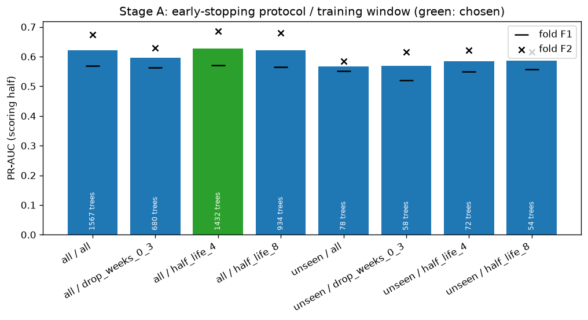
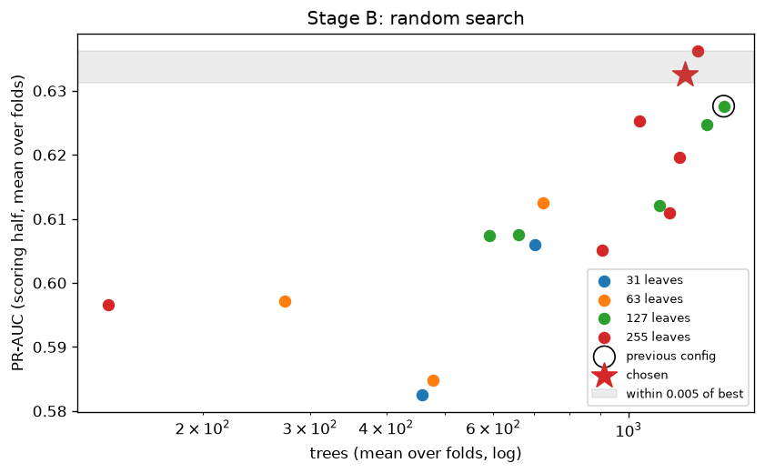
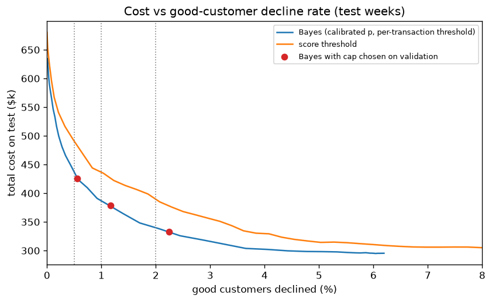
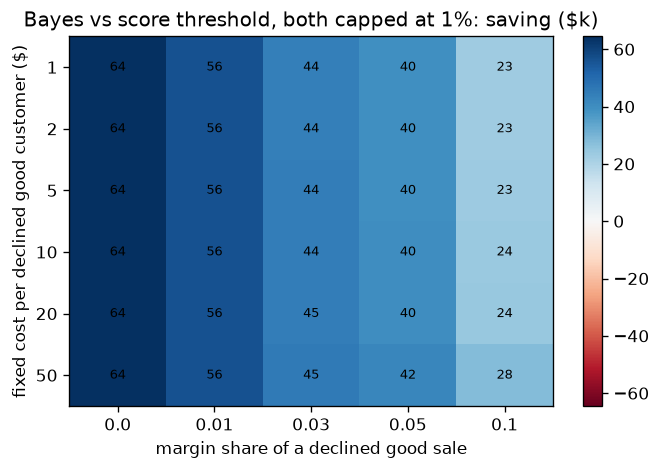
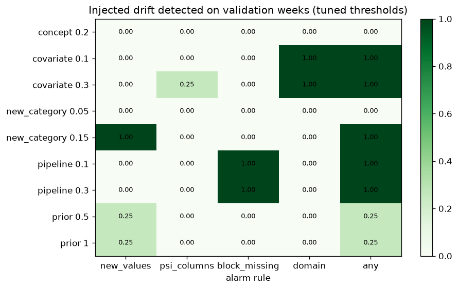
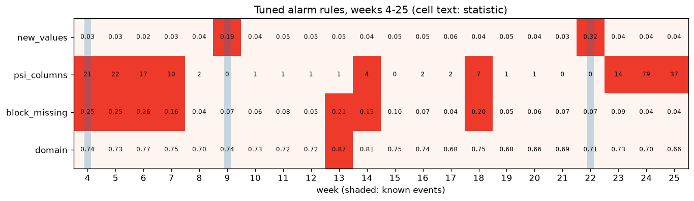

# Tuning

What [`method_research.md`](method_research.md) marked "to tune", tuned on weeks 0–19 only. **The test weeks (20–26) were used once**, after every choice was made, to compare the tuned version with the one before. Notebooks: [`06_tuning_scoring`](../notebooks/06_tuning_scoring.ipynb), [`07_tuning_decision`](../notebooks/07_tuning_decision.ipynb), [`08_tuning_monitoring`](../notebooks/08_tuning_monitoring.ipynb).

## Summary

| | Before | After tuning | Test result |
|---|---|---|---|
| P1 scoring | LightGBM, all weeks equal, 127 leaves | Recency weights (half-life 4 weeks), 255 leaves, min 20 rows per leaf, learning rate 0.05 | PR-AUC 0.534 → **0.545**, +0.012 (+0.003, +0.020) |
| P2 decision | Cost rule, no limit: 6.2% of good customers declined | Cost rule with a **1% cap** on declined good customers (Lagrange penalty) | Saves $310k vs approve-all; **$44k cheaper than a score threshold at the same decline rate** (22k–70k) |
| P2 3-action | No limit | Same 1% cap | Saves $478k; 1.2% of good customers declined; 7.1% reviewed |
| P3 monitoring | Alarm rules untuned: 14–22 of 22 weeks alarmed | 4 tuned rules | **0 alarms in 10 clean weeks**; every alarm is a known event or a change found in notebook 05 |

---

## P1. Scoring

**Protocol, fixed before running.**
- Two rolling-origin folds: F1 trains on weeks 0–11 and validates on 12–15; F2 trains on 0–15 and validates on 16–19.
- In each validation window, card holders are split in two. One half drives early stopping, the other half scores the configuration (≈1,650 frauds per fold).
- Selection by mean PR-AUC over the two folds. Among configurations within 0.005 of the best, the simplest wins.

### Stage A: early-stopping protocol × training window

Driven by two findings: card-holder features mostly helped on known card holders, and December 2017 is a different regime.

| Early stopping on | Training window | PR-AUC F1 | PR-AUC F2 | Mean | Trees |
|---|---|---|---|---|---|
| **all card holders** | **recency weights, half-life 4 weeks** | 0.570 | 0.685 | **0.628** | 1,432 |
| all | half-life 8 weeks | 0.565 | 0.679 | 0.622 | 934 |
| all | all weeks equal (before) | 0.568 | 0.674 | 0.621 | 1,567 |
| all | drop weeks 0–3 | 0.563 | 0.629 | 0.596 | 680 |
| unseen card holders only | (best of 4 windows) | 0.556 | 0.615 | 0.586 | 55 |

- **The memorisation hypothesis was wrong.** Stopping on unseen card holders only stops after 33–124 trees and loses about 0.04 PR-AUC. Returning customers exist in production too, so recognising their history is useful rather than a flaw. Early stopping stays on all card holders.
- **Recency weighting beats both extremes.** Keeping December with less weight (+0.0065 over equal weights, above the 0.005 tolerance) works better than dropping it (−0.025). This is a better answer to the "December is a different regime" finding than dropping the data.

### Stage B: hyperparameters

Random search, 17 configurations × 2 folds: the previous configuration plus 16 random draws. Space: num_leaves {31, 63, 127, 255}, min_child_samples {20…500}, colsample {0.3…0.9}, subsample {0.6, 0.8, 1.0}, reg_lambda {0…20}.

| Config | Leaves | Min rows/leaf | Colsample | Subsample | λ | Mean PR-AUC | Log loss | Trees |
|---|---|---|---|---|---|---|---|---|
| 7 (best) | 255 | 20 | 0.3 | 1.0 | 0 | 0.636 | 0.235 | 1,299 |
| **16 (chosen)** | 255 | 20 | 0.9 | 0.8 | 1 | 0.633 | 0.157 | 1,237 |
| 0 (previous) | 127 | 100 | 0.5 | 0.8 | 1 | 0.628 | 0.142 | 1,432 |

- Configuration 16 is within 0.005 of the best and simpler (same leaves, fewer trees). It also avoids the very poor log loss of config 7, which has no L2 regularisation.
- Small trees (31–63 leaves) or large minimum leaf sizes lose 0.02–0.05: the signal needs fine-grained interactions, consistent with the small, risky slices found in the analysis.

### Final model and the one test evaluation

Configuration 16 + recency weights, learning rate 0.05 (2,314 trees), trained on weeks 0–15. Test weeks 20–26, against S4 (the model before tuning):

| | PR-AUC (95% CI) | $ PR-AUC | $ caught at 1% / 3% | PR-AUC seen / new card holders | Raw log loss |
|---|---|---|---|---|---|
| S4 before | 0.534 (0.504–0.561) | 0.448 | 16.3% / 40.7% | 0.637 / 0.526 | 0.171 |
| **Tuned** | **0.545** (0.515–0.574) | 0.456 | 16.1% / 41.3% | 0.668 / 0.537 | 0.154 |

- Paired difference, tuned − S4: PR-AUC **+0.0115 (+0.0026, +0.0200)**; $ PR-AUC +0.0084 (−0.0041, +0.0210).
- **Reading.** Tuning gave a real but modest gain in ranking (about 2%), and the CI for dollars includes 0. As expected for a model that was already reasonable, the bigger levers are in the decision layer (P2).

---

## P2. Decision

**Calibration**, chosen by cross-fitting inside the validation scoring half: Platt out-of-fold log loss 0.0802 vs isotonic 0.0823. **Platt** was chosen; on test its log loss is 0.0899 and ECE 0.0023.

**A cap on declined good customers.** The cost-optimal rule declined 6.2% of good customers on test (with the tuned model), because the assumed costs leave out churn and lifetime value.
- The cap (default 1%, `costs.yaml`) is enforced with a Lagrange penalty λ: decline if p·C_FN > (1 − p)·(C_FP + λ). λ is set on the validation half.
- At a 1% cap, λ = $47.3. This is the **shadow price** of the cap: limiting declines to 1% acts as if each declined good customer cost $47 more than the assumed $5 + 3% of the amount.

| Policy (test weeks) | Total cost | Saving vs approve-all (95% CI) | Good customers declined | Fraud $ stopped |
|---|---|---|---|---|
| Approve all | $688.6k | — | 0% | 0% |
| Threshold 0.5 (before) | $540.8k | $147.8k (130.0k–165.7k) | 0.21% | 20.7% |
| Cost rule, no cap | $295.4k | $393.2k (336.8k–455.1k) | 6.19% | 71.2% |
| Score threshold, cap 1% | $423.0k | $265.6k (230.1k–307.0k) | 1.19% | 40.0% |
| **Cost rule, cap 1%** | **$378.6k** | **$310.0k** (263.3k–364.9k) | 1.17% | 49.4% |
| **3-action, cap 1%** | **$210.6k** | **$478.0k** (422.0k–541.4k) | 1.22% (+7.1% reviewed) | 76.5% |

At the **same cap**, cost rule minus score threshold (negative = cost rule cheaper):

| Cap | Cost rule | 3-action |
|---|---|---|
| 0.5% | −$56.8k (−83.9k, −33.4k) | −$265.9k (−313.6k, −223.1k) |
| 1% | −$44.4k (−69.8k, −22.4k) | −$212.4k (−251.9k, −174.0k) |
| 2% | −$48.4k (−68.8k, −27.8k) | −$178.7k (−213.2k, −145.4k) |

**Robustness.**
- Over the 30 cost scenarios, the capped cost rule beats the capped score threshold in **30 of 30**, by $23k–$64k.

  

- Over review assumptions (cost $1–$10 per case, reviewers stop 70–100% of fraud), 3-action with the cap beats the capped cost rule by $65k–$217k in every case.

**Reading.**
- **Where the amount enters the rule matters even when the decline rate is fixed.** At any given share of declined good customers, the per-transaction threshold spends those declines on the large transactions where fraud costs most. This is the analysis finding "rate ≠ loss" turned into money.
- **The cap costs about $83k** compared with the unconstrained rule ($393k → $310k). This is the price of keeping 98.8% of good customers untouched, and the business should decide on it.
- **Caveat: the cap is slightly exceeded out of sample** (1.17–1.22% on test for a 1% target). Production should set the target below the hard limit, for example 0.8–0.9%.
- **Caveat: the 3-action saving depends on review assumptions** that need business input, although it stays positive across the whole range tried.

---

## P3. Monitoring

**Design.**
- Thresholds are set on 6 clean tuning weeks (8, 10, 11, 12, 15, 16), allowing at most 1 alarm in 10 clean weeks per rule.
- They are checked on 4 clean validation weeks (17, 19–21), on injected drift in those weeks, and on all weeks 4–25.
- The domain classifier drops the 62 columns whose rank correlation with time exceeds 0.1. Only 3 columns exceed 0.3, so time-trend columns explain little of its baseline AUC of 0.66–0.75. The fix that matters is the relative threshold.

**Tuned rules** (alarm when the statistic is above the threshold):

| Rule | Statistic | Clean tuning weeks | Threshold |
|---|---|---|---|
| New values | Largest share of never-seen values in a categorical column | 0.036–0.054 | **0.058** |
| PSI columns | Numeric columns significant after FDR with PSI > 0.1 | 0–2 | **≥ 3** |
| Block missing | Largest change in a V block's missing rate | 0.036–0.095 | **0.097** |
| Domain | Domain-classifier AUC (trend columns removed) | 0.700–0.747 | **0.815** |

**Injected drift** (detection rate on the 4 validation weeks; false alarms on the same weeks without injection: 0 of 4):

| Scenario | Detected by | Rate |
|---|---|---|
| Pipeline: a block missing on 10% / 30% of rows | block missing | 100% / 100% |
| Covariate: amount and C1 × 1.1 / × 1.3 | domain classifier | 100% / 100% |
| New browser value on 5% / 15% of rows | new values | **0%** / 100% |
| Prior shift: fraud rate × 1.5 / × 2 | — | 25% / 25% |
| Concept shift: 20% of labels flipped | — | **0%** (by construction) |

**Replay, weeks 4–25:** alarms in weeks 4–7 (V-block step and the weeks after it), 9 and 22 (browser releases), 13, 14, 18 and 23–25 (changes found in notebook 05), and **no alarm in any of the 10 clean weeks**.

**Reading.**
- **The four rules are complementary.** Each injected scenario is caught by a different rule. A 2-column covariate shift does not reach the "3 columns" rule but the domain classifier sees it; a pipeline break is seen only by the block rule.
- **Detection limits are now known:**
  - New values on 5% of rows are inside the normal weekly churn (up to 5.4–5.6% in clean weeks), so they are not detected.
  - Prior shift barely changes the features, so it is caught 25% of the time.
  - Concept shift leaves every label-free statistic unchanged, which was verified.
- **Prior and concept shift need labels or CBPE.** Label-free monitors cannot replace the delayed label check; this is the argument for keeping both.
- **Caveat.** "Clean" weeks were chosen from the analysis and notebook 05, and only 4 were left for validation. The false-alarm rate is therefore known only roughly: 0 of 10 is consistent with anything up to about 26% at 95% confidence.

---

## What changed in the configuration

- **`configs/model.yaml` → `tuned`:** early stopping on all card holders, half-life 4 weeks, 255 leaves, min 20 rows per leaf, colsample 0.9, subsample 0.8, λ 1, learning rate 0.05, Platt calibration.
- **`configs/costs.yaml` → `constraints.max_good_decline_rate: 0.01`.**
- **`configs/monitoring.yaml` → `alarm_rules`:** 0.058 / ≥ 3 columns / 0.097 / 0.815, trend cut 0.1.

## Next

- P4 can now be backtested with these components.
- Open items:
  - a cap target with a safety margin;
  - review assumptions from the business;
  - CBPE as the prior-shift monitor.
